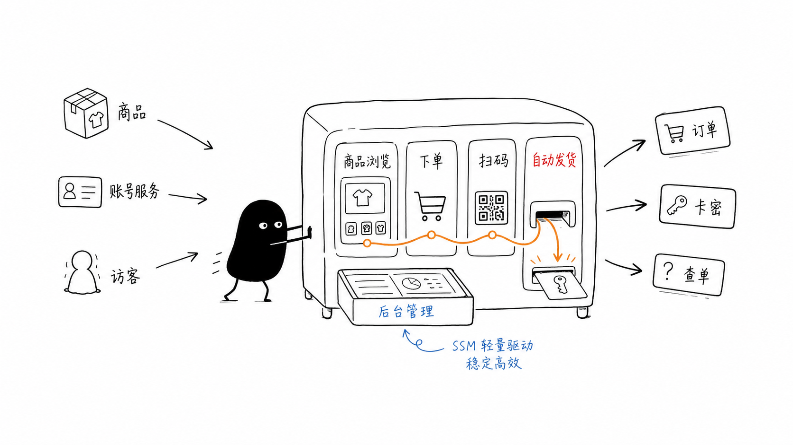
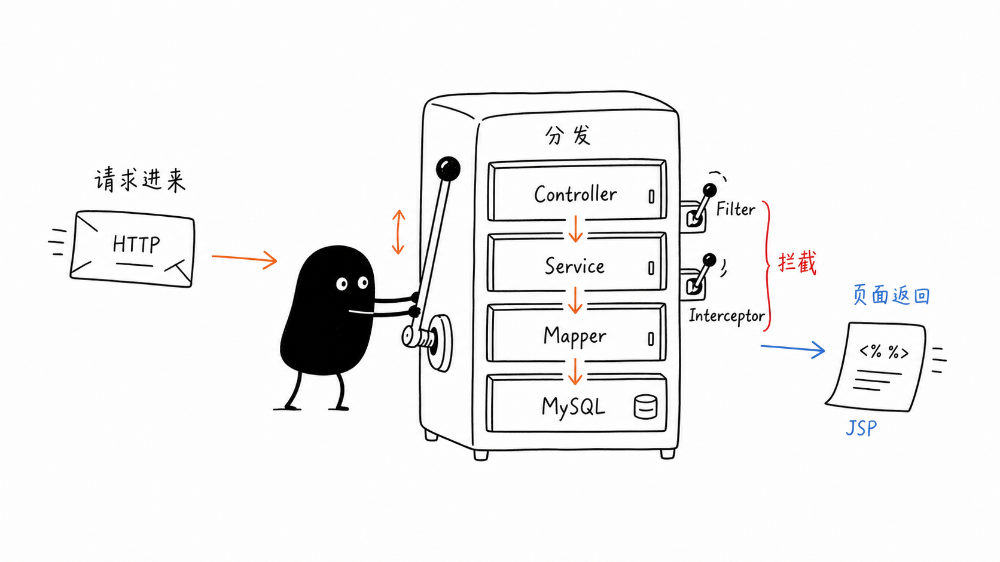
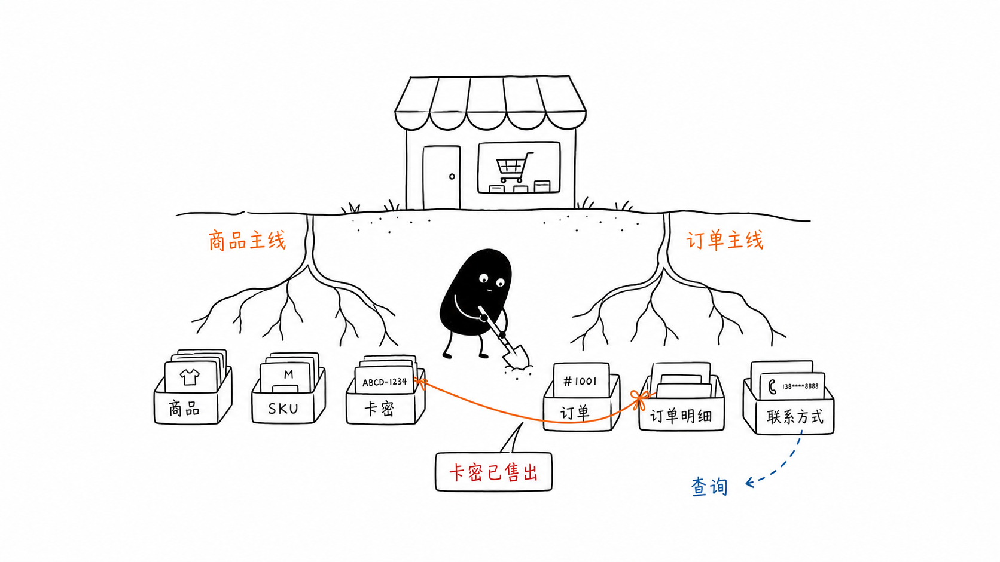
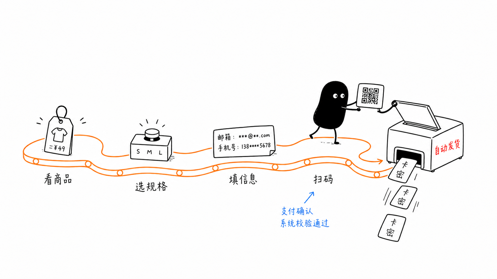
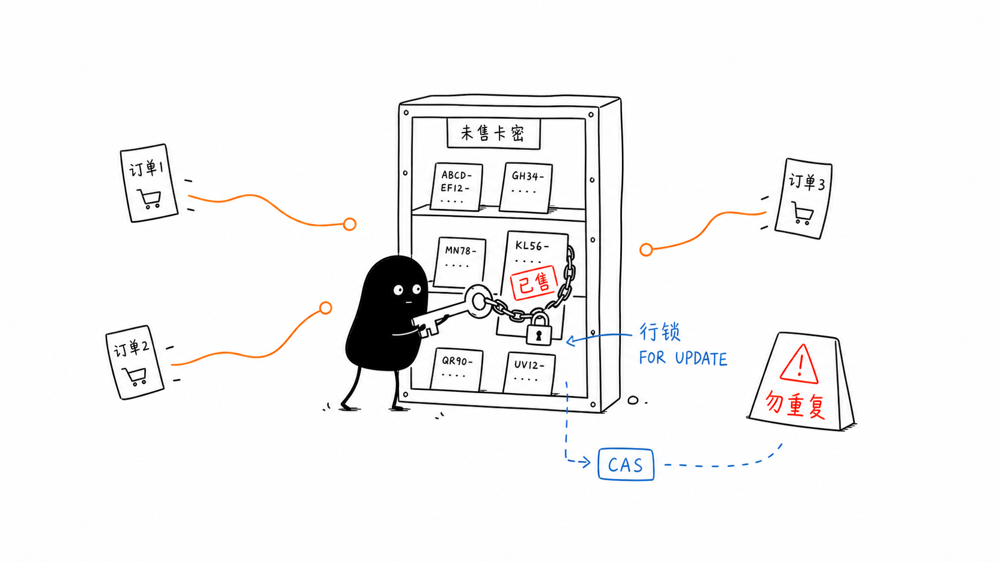
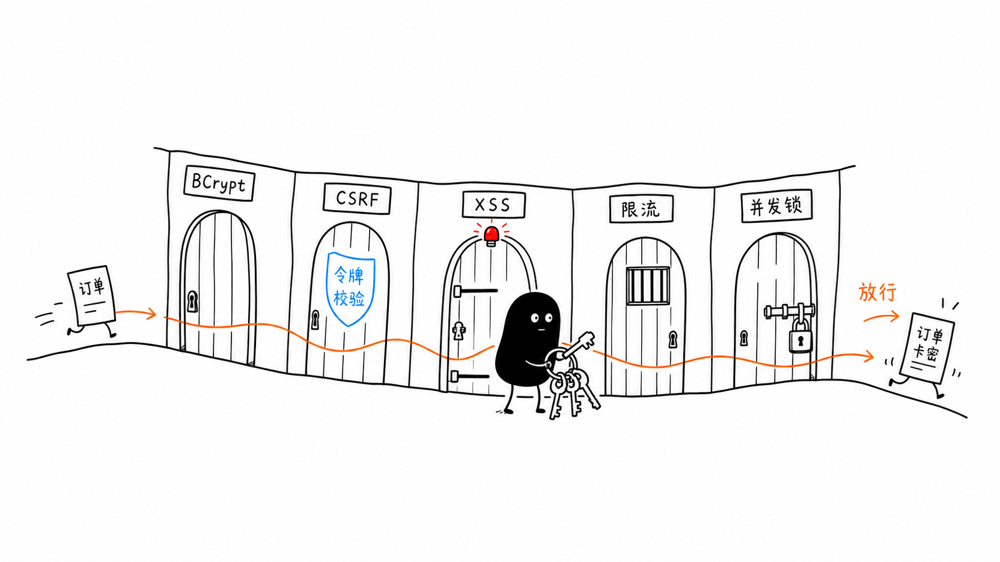
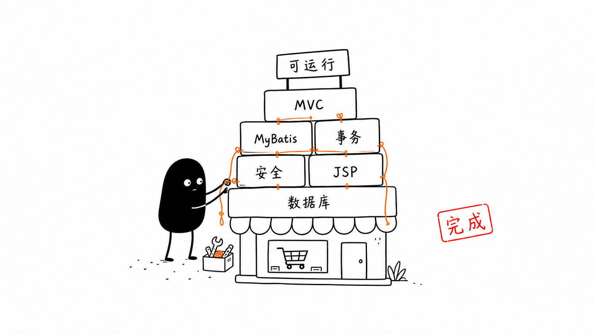

# 虚拟数字商城 - SSM课程设计

<p align="center">
  
</p>

<p align="center">
  <strong>基于 SSM（Spring + SpringMVC + MyBatis）框架的虚拟数字产品在线商城</strong><br>
  支持商品浏览 · 在线下单 · 扫码支付 · 卡密自动发货 · 匿名查单
</p>

---

## 技术栈

| 层级 | 技术 | 版本 |
|------|------|------|
| 后端框架 | Spring + SpringMVC + MyBatis | 6.2.1 / 3.5.16 |
| 数据库 | MySQL + Druid 连接池 | 8.0+ / 1.2.23 |
| 前端 | JSP + Bootstrap 5 + 自定义 CSS | 5.3 |
| 安全 | BCrypt 密码 + CSRF Token + XSS 转义 | — |
| 日志 | Logback | 1.5.6 |
| 构建 | Maven + Tomcat (Jakarta EE) | JDK 23 |

---

## 项目架构

<p align="center">
  
</p>

项目采用经典 SSM 三层架构：

```
浏览器 → DispatcherServlet → Controller → Service → Mapper (MyBatis) → MySQL
                                ↑              ↑
                          Interceptor      @Transactional
                          (鉴权/CSRF)      (事务管理)
```

- **Controller**：接收请求、参数校验、响应分发
- **Service**：业务逻辑、事务管理、异常处理
- **Mapper**：MyBatis SQL 映射、数据库操作
- **Filter/Interceptor**：CSRF Token 生成验证、登录鉴权

---

## 数据库设计

<p align="center">
  
</p>

共 **7 张核心表**，围绕 `product` 和 `mall_order` 两条主线：

```
user ──1:N──→ mall_order ──1:N──→ order_item
                                    ↑
product ──1:N──→ product_sku ──1:N──┘
                       ↓
                   card_key (卡密)
```

| 表名 | 核心字段 | 说明 |
|------|---------|------|
| `user` | username, password(BCrypt) | 用户账户 |
| `product` | name, category_id, price | 商品信息 |
| `product_sku` | product_id, spec_name, stock | 库存由卡密数自动决定 |
| `mall_order` | order_no, contact, status | 0待支付/2完成/3取消 |
| `card_key` | sku_id, content, status | 0未售/1已售/2冻结 |

---

## 核心业务流程

<p align="center">
  
</p>

### 购物流程

```
浏览选品 → 选规格填信息 → 提交订单 → 扫码支付 → 自动发货（卡密发放）
```

用户确认付款后，系统在 `@Transactional` 事务中自动完成：
1. `SELECT ... FOR UPDATE` 锁定卡密
2. 批量更新卡密状态为已售（CAS 乐观锁）
3. 扣减 SKU 库存、更新销量
4. 订单标记完成

### 并发安全

<p align="center">
  
</p>

- **悲观锁**：`SELECT ... FOR UPDATE` 锁定目标卡密行
- **CAS 乐观锁**：`WHERE status = #{expectedStatus}` 防并发覆盖
- **库存同步**：库存 = 未售卡密数（派生值），自动增减

---

## 安全设计

<p align="center">
  
</p>

| 安全机制 | 实现方式 |
|---------|---------|
| **BCrypt 密码加密** | cost=12 哈希存储，兼容旧 MD5 回退验证 |
| **CSRF Token 防护** | Filter 生成 Token，POST 表单 hidden 字段验证 |
| **XSS 防护** | 30+ 处输出使用 `fn:escapeXml()` 转义 |
| **登录限流** | Session 级失败计数，5 次锁定 + Fixation 防护 |
| **并发控制** | 悲观锁 + CAS 双重保障，所有写操作 @Transactional |

---

## 部署运行

### 环境要求

| 组件 | 版本要求 | 说明 |
|------|---------|------|
| JDK | 23+ | 项目编译和运行 |
| Maven | 3.6+ | 依赖管理和项目构建（IDEA 自带） |
| MySQL | 8.0+ | 数据库 |
| Tomcat | 10.1+ | Servlet 容器（需支持 Jakarta EE） |
| IDEA | 推荐 Ultimate | 社区版需额外配置 Tomcat 插件 |

### Step 1：克隆项目

```bash
git clone https://github.com/你的用户名/virtual-mall.git
cd virtual-mall
```

### Step 2：创建数据库

登录 MySQL 后执行初始化脚本，自动建库、建表、插入 63 个初始商品数据：

```sql
-- 方式一：命令行
mysql -u root -p < src/main/resources/init.sql

-- 方式二：MySQL 客户端
source /你的项目路径/src/main/resources/init.sql;
```

### Step 3：修改数据库配置

编辑 `src/main/resources/db.properties`，填入你的 MySQL 密码：

```properties
jdbc.driver=com.mysql.cj.jdbc.Driver
jdbc.url=jdbc:mysql://localhost:3306/virtual_mall?useUnicode=true&characterEncoding=utf8&serverTimezone=Asia/Shanghai
jdbc.username=root
jdbc.password=你的MySQL密码
```

> 也支持环境变量方式（Linux/Mac）：`export DB_PASSWORD=你的密码`，配置文件会自动读取。

### Step 4：IDEA 导入项目

1. **File → Open** → 选择项目根目录（含 `pom.xml` 的文件夹）
2. 等待 Maven 自动下载依赖（右下角进度条完成）
3. 如果提示 Maven 未配置，进入 **File → Settings → Build → Build Tools → Maven**，确认 Maven 路径正确

### Step 5：配置 Tomcat

1. **Run → Edit Configurations → + → Tomcat Server → Local**
2. **Application server**：点击 Configure 选择本地 Tomcat 安装目录
3. **Deployment** 选项卡：点击 + → Artifact → 选择 `virtual-mall:war exploded`
4. **Application context** 设为 `/`
5. **Server** 选项卡：HTTP port 设为 `8080`

> 如果没有 Tomcat，先下载 [Apache Tomcat 10.1](https://tomcat.apache.org/download-100.cgi)，解压后在 IDEA 中配置。

### Step 6：启动运行

1. 点击绿色 ▶️ 运行按钮
2. 等待控制台显示 `Artifact is deployed successfully`
3. 浏览器访问 `http://localhost:8080/`

### 测试账号

| 角色 | 账号 | 密码 | 说明 |
|------|------|------|------|
| 管理员 | admin | admin123 | 后台管理全部功能 |
| 测试用户 | testuser | 123456 | 前台下单、查单 |
| 访客 | 无需登录 | — | 可直接浏览商品、下单、支付 |

---

## 项目结构

```
src/main/java/com/mall/
├── controller/     # 控制层（shop/user/admin）
├── service/impl/   # 业务层（@Transactional）
├── mapper/         # MyBatis Mapper 接口
├── entity/         # 实体类
├── filter/         # CsrfTokenFilter
├── interceptor/    # LoginInterceptor, AdminInterceptor
└── util/           # PasswordUtil, CsrfToken, OrderNoGenerator

src/main/resources/
├── mapper/         # MyBatis XML 映射（8 个）
├── spring-*.xml    # Spring 配置（dao/service/web）
├── logback.xml     # 日志
├── db.properties   # 数据库连接
└── init.sql        # 建表 + 63 个初始商品

src/main/webapp/
├── views/          # JSP 页面（前台 12 + 后台 10）
├── static/css/     # 样式（含 about 手稿风）
├── static/fonts/   # 手写字体（ZCOOL KuaiLe 等）
└── static/images/  # 商品封面 + about/ 文档配图
```

---

## 页面清单

### 前台
| 路由 | 说明 |
|------|------|
| `/` | 首页（商品推荐 + 分类入口） |
| `/product/list` | 全部商品（分类筛选 + 搜索） |
| `/product/detail/{id}` | 商品详情（SKU 选择 + 购买） |
| `/order/create` | 确认订单 |
| `/order/pay/{orderNo}` | 支付页面 |
| `/order/success/{orderNo}` | 支付成功（显示卡密） |
| `/order/query` | 订单查询（匿名） |
| `/user/login` | 用户登录 |
| `/user/register` | 用户注册 |
| `/about` | **项目技术文档**（黑白手写线稿风） |

### 后台
| 路由 | 说明 |
|------|------|
| `/admin/index` | 后台首页（数据统计） |
| `/admin/product/*` | 商品管理 + 规格管理 |
| `/admin/category/*` | 分类管理 |
| `/admin/order/*` | 订单管理 |
| `/admin/cardkey/*` | 卡密管理（导入/冻结/解冻） |
| `/admin/user/*` | 用户管理 |

---

## 技术收获

<p align="center">
  
</p>

通过本项目实践了 SSM 全栈开发，掌握了：
- Spring MVC 请求分发与拦截器机制
- MyBatis 动态 SQL 与事务管理
- BCrypt 密码安全与 CSRF/XSS 防护
- 悲观锁 + CAS 乐观锁的并发控制
- JSP + Bootstrap 前端页面开发
